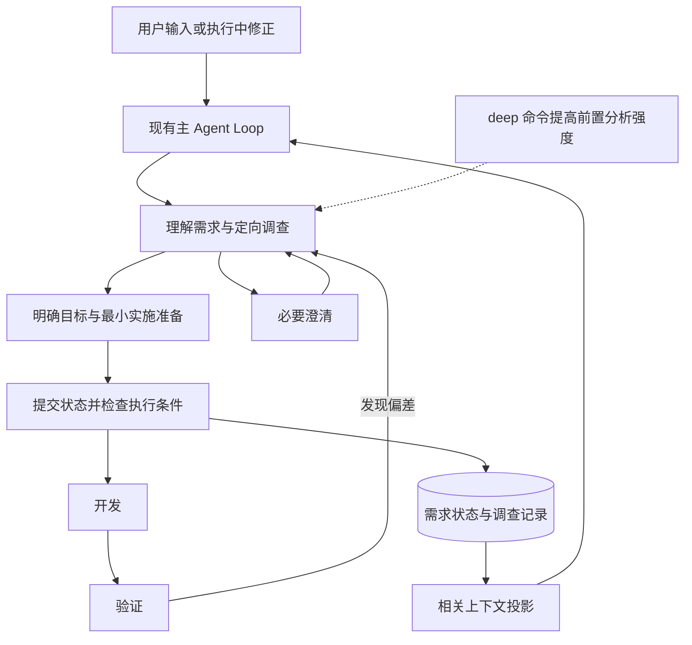
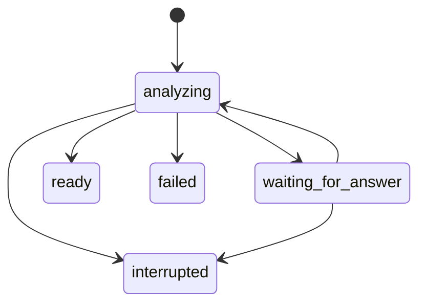

# Intent Engine 开发设计文档

版本：0.1  
日期：2026-11-12  
适用项目：Kimi Code  
代码基线：`77ebf2a408d060751dbca90e11edcb4a248f3a77`  
状态：第一版实验实现已落地，默认关闭；工程回归已建立，真实模型质量与成本校准仍为灰度前置条件。

Intent Engine 为当前会话任务维护可持续更新的需求理解，并通过一次性的 `/deep` 深入分析提前发现目标偏差。需求理解、代码调查、实施准备、开发和验证共用现有 Agent 执行流程，避免分析完成后再从头调查和规划。

本文面向引擎、SDK、CLI 和测试开发人员。已确认的产品决策构成第一阶段范围；服务名称、事件名称、字段名和模块划分是建议实现基线，可按仓库现有模式调整，但必须保持本文的行为约束。原设计待冻结事项见第 15 节，本次实施采用的基线与验证边界见第 16 节。

## 1 已确认的产品决策

| 编号 | 决策 |
| --- | --- |
| P01 | 第一阶段管理当前会话中的当前任务，跨会话项目需求库留待后续。 |
| P02 | 使用简短文本展示关键目标、假设、待决定事项和需求变化。 |
| P03 | 默认持续维护需求状态，优先减少需求遗忘和执行偏离。 |
| P04 | `/deep` 用于执行前深入理解问题、推断目标并澄清关键歧义。 |
| P05 | `/deep` 只作用于当前任务的一次分析阶段，结束后恢复默认流程；分析可跨多个模型步骤和问答回合。 |
| P06 | 深入分析与后续开发共享成果，合并必要的代码调查和初步实施准备，减少重复推理。 |
| P07 | 尽量复用现有架构、工具、上下文、持久化和 Subagent 能力，保持模型无关。 |
| P08 | 对整个任务的质量、token、延迟和返工成本进行评估，先建立最小可行框架。 |

### 1.1 第一阶段交付范围

第一阶段需要同时具备默认需求跟踪和 `/deep`，形成从用户输入到需求更新、执行反馈、验证依据的完整闭环。

- 记录目标、约束、假设、未知项、决策和验收条件，并保留来源。
- 接收新请求和执行中的用户修正，支持必要澄清。
- 持久保存需求状态，在恢复和上下文压缩后继续使用。
- 保留少量可复用的调查结论、证据引用及下一步行动。
- 支持 `/deep` 的开始、澄清、完成、取消、预算耗尽和失败路径。
- 为子代理提供相关需求切片，汇总其发现和变更建议。
- 统计默认维护与深入分析的成本，提供行为和成本回归用例。

### 1.2 后续扩展范围

跨会话需求库、多目标并行管理、知识图谱、向量检索、复杂证据依赖图、独立需求面板、自动学习的澄清策略，以及专用分析模型路由，均不作为第一阶段依赖。

新增能力先通过实验开关发布。产品上的“默认持续跟踪”指该能力开启后的工作方式，不代表第一版对所有现有用户默认开启。

## 2 现有架构与复用边界

### 2.1 当前请求链路

TUI/CLI 经 SDK 和 Klient 将请求提交到引擎；服务端也可以将客户端消息直接送入 `submit` 或 `sendNow`。核心执行发生在 `agent-core-v2`：模型读取上下文，生成回答和工具调用，工具结果进入历史，循环继续或结束。

初始上下文包括项目指令、工作目录、Skills、插件信息及可用工具。项目代码事实由读取和搜索工具逐步获得。现有主链路没有统一的需求事实库，理解和规划主要由模型在当前上下文中完成。

核心意图策略必须位于引擎层。客户端负责命令入口和展示，不各自实现不同的需求状态机。

### 2.2 能力清单

| 现有模块 | 已有职责 | 本次复用方式 | 不应假定已有的能力 |
| --- | --- | --- | --- |
| Feature 与 DI Scope | 注册服务、工具、配置和命令 | 新增 `IntentFeature`，接入现有生命周期 | 注册 Feature 不会自动完成全部客户端接入 |
| Agent Loop | 请求队列、steering、模型调用、工具执行、hooks | 连续推进分析和开发，观察输入与结果 | 所有 Core hooks 并非都已对 Feature 公开 |
| Agent 持久状态 | durable events、回放、恢复、可选撤销 | 主 Agent 保存权威需求 | 不等同于跨多个事件的事务 |
| SessionState | 普通状态注册 | 可承载临时共享视图 | `SessionModelContribution` 尚不能视为完整可用的持久化通路 |
| Reminder | step 前注入、disclosure、压缩后重新注入 | 提供需求摘要和增量提醒 | 去重不等于后续输入 token 为零 |
| Plan | 计划模式、正文版本、退出审核与工具限制 | 关联需求版本和实施方案 | Plan 不承担用户需求事实的所有权 |
| Todo 与 Task | 执行步骤及运行状态 | 记录进度和后台工作 | 完成任务不代表验收条件全部满足 |
| Goal | 目标、完成条件、持续执行与预算 | 在用户已使用 Goal 时关联需求 | 创建 Intent 不自动创建 Goal |
| AskUserQuestion | 前台和后台问答 | 承载问题及答案 | 非交互模式、权限或客户端能力可能限制问答 |
| Subagent | 独立执行、调查、结果和生命周期事件 | 有边界的专项调查 | 子代理输出不是用户确认，也不天然是结构化需求变更 |
| Requester 与 Usage | 模型适配、请求执行、消耗记录 | 保持模型无关并增加归因 | Goal token 预算不覆盖全部输入、辅助调用及子代理成本 |

### 2.3 需要特别处理的现有边界

`onBeforeSubmitPrompt` 位于普通请求启动路径，执行中追加的输入走不同路径。新功能必须覆盖普通提交和 steering，不能只挂一个提交前 hook。

现成的业务状态持久化主要位于 Agent 域。建议第一阶段业务上服务整个当前任务，技术上由主 Agent 持有，采用成熟的 Agent durable 模式。真正的 Session durable aggregate 留待有明确需求时扩展。

引擎命令和 SDK 的 `runCommand` 已存在，但 TUI slash 命令使用自己的注册和分派逻辑，必须增加薄适配。浏览器和 headless 不会自动继承 TUI 的命令行为。

## 3 推荐整体设计

### 3.1 模块职责

建议在 `packages/agent-core-v2/src/features/intent` 内实现逻辑独立的功能模块，先使用一个主服务和若干纯函数，不拆分新进程或工作区包。

| 建议组成 | 职责 | 边界 |
| --- | --- | --- |
| Intent state | 保存需求、版本、来源和少量调查成果 | 不保存完整聊天、重复代码或完整推理过程 |
| Intent service | 统一处理更新、分析阶段和生命周期 | 主 Agent 负责协调，服务负责校验与提交 |
| Intent projection | 生成当前工作相关的紧凑摘要 | 不将全量历史逐步重复注入 |
| Intent policy | 判断结构性阻塞、版本有效性、阶段工具范围和预算 | 语义理解仍由模型完成 |
| Intent tools | 读取状态、提交增量、声明分析已具备执行条件 | 不接受无来源的“已确认”断言 |
| Deep command adapter | 校验命令并启动一次分析 | 不在命令 RPC 内阻塞整个多轮过程 |

这些名称描述职责，最终文件和服务数量由实现复杂度决定。Intent 与已有 Plan、Todo、Task、Goal 通过 ID、版本和只读视图关联，避免复制它们的状态和生命周期。

### 3.2 统一执行流程

默认流程按需展开理解和调查；`/deep` 在修改项目之前主动检查关键解释、目标假设和影响方向的证据。两者使用同一主 Agent 和历史，不在分析结束时新建开发 Agent、重置上下文或强制生成第二份完整计划。

分析结束后保留已获结论并继续原授权范围。原任务只要求讨论时，分析完成也不授权代码修改。已有 Plan 模式和工具权限继续生效。

### 3.3 不可破坏的行为约束

- 用户明确要求必须保留来源；模型推断不能自动提升为用户确认。
- 一次任务只有一个需求写入入口，子代理不能直接覆盖权威状态。
- 用户中途纠正与最初请求具有同等重要性，旧结果不能覆盖新要求。
- 分析完成、任务完成和验收通过是不同状态。
- 取消、预算耗尽、存储失败都不能伪装成分析成功。
- 不依靠模型内部推理记忆、供应商缓存或自由文本解析维持状态正确性。
- 阶段限制只能收紧当前可执行范围，不能扩大现有授权。

## 4 产品行为

### 4.1 默认需求维护

新任务开始时，服务记录原始请求引用，模型在正常推理中识别目标、约束和未知项。存在实质更新时通过结构化接口提交，普通回答不需要固定增加一次独立分析调用。

用户补充输入、相关调查结果、明确冲突和准备交付是主要复核时点。运行时标记需要复核的对象，下一次正常推理决定是否更新需求；一次工具失败或测试失败不能直接推导为需求变化。

建议在已存在当前任务且出现尚未处理的用户修正时，于下一次项目修改前要求主 Agent 提交需求增量，或明确声明该输入不改变当前需求并记录理由。只读调查和纯回答可以继续。这可能增加一个工具步骤，应计入默认维护成本；不承诺无额外步骤。

新消息不自动创建新任务。明确切换目标时创建新的 `intentId`，保留前一任务记录；关系不明确时保持当前任务并由模型判定或澄清。

### 4.2 Deep 命令

| 输入或场景 | 建议行为 |
| --- | --- |
| `/deep <需求描述>` | 将描述作为本次请求，进入一次前置深入分析；与已有任务的关系按普通请求规则处理 |
| 单独 `/deep` 且有当前任务 | 使用当前任务状态和已有证据开始分析 |
| 单独 `/deep` 且无当前任务 | 给出简短用法提示，请用户补充需求 |
| 当前主任务正在执行 | 第一版返回忙碌提示，保留用户输入，不静默排入可能已经太晚的前置分析 |
| 存在相关的后台修改任务 | 阻止启动并说明需要先处理哪些运行任务，不擅自终止其他工作 |
| 同一任务重复提交相同启动请求 | 幂等返回已有分析运行，不创建重复作业 |
| 已完成一次分析后再次明确调用 | 创建新的分析运行，优先复用仍然有效的成果 |

命令不是会话开关，不提供默认的持久 `on/off` 语义。一次分析可以因为澄清跨越多个 turn，但不会自动影响后续新任务。

### 4.3 深入分析步骤与完成条件

1. 明确用户希望解决的问题，区分期望结果与用户提出的候选实现。
2. 复用当前有效证据，调查影响目标或方向的关键代码路径。
3. 比较确实会改变实施方向的解释和方案，记录选择理由。
4. 澄清阻塞问题，形成目标、范围、约束和验收依据。
5. 记录最小实施准备，提交分析完成状态并继续原授权工作。

深入分析只需达到足以可靠选择下一步的程度。关键产品问题未解决时，不提前展开大量函数级设计；局部细节可以临近修改时补充。

完成条件包括：目标可执行、关键约束有记录、影响下一步的未知项已解决或已有明确处理方式、验收依据可用。仍可存在不阻塞下一步的未知项。模型提出完成建议，服务检查来源、版本、阻塞项和阶段状态；这些结构检查不能证明语义理解绝对正确。

### 4.4 简短文本展示

复杂任务建立理解、关键假设改变、需要决定或深入分析完成时，展示一段简短说明。简单明确的请求不强制输出需求模板。

示例：

> 当前目标是缩短首次可交互时间，并保留现有 CLI 参数行为。已定位主要初始化路径，接下来先处理其中的等待过程。后台预加载是否可接受仍待确认，因此暂不采用该方案。

展示内容从同一份状态生成，不再调用模型撰写单独的长交接报告。用户可用自然语言纠正；无需第一版就增加可编辑面板。

## 5 数据模型与所有权

### 5.1 当前任务状态

| 字段或记录 | 用途 |
| --- | --- |
| `schemaVersion` | 标识持久数据版本，支持兼容读取和迁移 |
| `intentId` | 当前任务的稳定标识，不等同于每条用户消息 |
| `revision` | 有效业务变更后的版本，无变化提交不递增 |
| `lifecycle` | 当前任务的进行中、已结束或已归档状态，与分析运行分开 |
| `items` | 目标、约束、假设、未知项及验收条件 |
| `decisions` | 已选方案、理由、适用范围和被替代的决策 |
| `findings` | 少量调查结论及证据引用 |
| `executionPreparation` | 影响模块、下一步行动和验证入口，关联现有计划与待办 |
| `sourceRefs` | 原始用户消息、答案、工具结果或代码证据引用 |
| 输入处理游标 | 区分已观察和已处理的用户消息，发现功能停用期间或恢复后的待复核输入 |

只有主 Agent 协调的 Intent service 能提交这些记录。未来直接编辑需求的 UI 也应经过同一入口。

### 5.2 条目的确定程度与来源

每条记录包含稳定 ID、内容、种类、适用范围、来源引用，以及 active 或 superseded 等有效性信息。确定程度与验收状态必须分开。

| 分类 | 含义 | 可接受依据 |
| --- | --- | --- |
| `explicit` | 用户明确表达的要求或决定 | 用户消息或明确回答，保留原文片段和引用 |
| `assumption` | 模型提出、尚未获得明确支持的解释或选择 | 推断理由及支持证据，不得标作用户确认 |
| `unknown` | 尚未确定的信息 | 关联问题、阻塞范围或调查方向 |
| 代码事实 | 对当前系统行为的观察 | 文件、工具结果、运行证据及版本 |
| 验收结果 | 条件是否满足 | 未验证、通过、失败或无法验证，以及对应证据 |

`sourceKind` 区分用户输入、用户回答、工具结果和子代理发现，均由运行时观察产生，模型不能自行创建来源。模型推断不作为来源类型：模型自建的来源再被自己引用，原文匹配无法证明任何事情；推断由条目的 `assumption` 或 `unknown` 确定程度表达，且明确要求只接受用户输入或用户回答作为依据。用户明确要求无需重复确认；仅有模型提交的确认标志不足以认定用户已确认。服务能验证来源存在及原文片段匹配，语义归纳正确性仍需行为评估。

新要求取代旧要求时保留替代关系。对于能明确识别的用户纠正，按最新要求更新；对于互相冲突且无法判断优先级的要求，记录冲突并澄清，不能静默选择。

### 5.3 分析运行状态

每次 `/deep` 维护独立的 `analysisRunId`、绑定的任务与版本、当前阶段、已解决问题、预算账本和结束原因。建议状态为：

`ready` 表示本次前置分析已完成，之后恢复默认跟踪。`interrupted` 包括取消、预算耗尽、运行恢复和功能停用；`failed` 包括运行或存储错误。它们都不表示需求已完成。只有同一有效 generation 中等待当前问题的正常答案可按匹配关系继续本次分析；中断或失败后的恢复必须有新的有效继续请求。

恢复时原来未完成的分析统一转为 `interrupted(reason=recovery)`。继续请求重新绑定当前任务、版本和问题，保留已有消耗与剩余预算；旧 generation 的问题答案只能作为待复核信息，不能自行恢复分析。明确再次调用 deep 可以建立新的分析运行，但不能因内部重试或恢复而自动重置预算。

### 5.4 并发版本与幂等

状态更新携带 `operationId`、`intentId`、`expectedRevision` 和当前任务视图的 generation 标识。先校验当前任务及 generation；在同一有效 generation 内，相同 ID 和相同内容的重试返回原提交结果，相同 ID 携带不同内容应拒绝。对尚未处理过的新操作再检查 expectedRevision。更新按主 Agent 的单一写入入口串行化。

幂等结果按任务和 generation 隔离。撤销、恢复或换任务后的旧操作不能仅因命中去重记录而返回当前成功；可提供历史结果供对账，但不能重新应用修改或恢复 ready 阶段。即使在同一 generation，重试返回的也是原操作结果，不代表当前任务仍处于当时的阶段。

Undo 可能把业务 revision 回退，不能只依靠 revision 拒绝旧异步结果。需要不会随业务撤销回退的 generation，或等价的视图有效性标识，在撤销、分支切换、恢复和任务切换时刷新。异步结果同时检查任务、generation 和版本；持久化实现可与业务状态分离，具体形式在接口评审中确定。

旧结果可以作为待复核证据返回主 Agent，但不能自动覆盖新状态。第一版采用拒绝过期提交加重新提议即可，不实现智能合并算法。

## 6 调查成果复用与证据失效

理解、调查和实施准备共享成果，但用户需求与实现细节保持各自所有权。发现记录可包含简短结论、关联需求 ID、文件或符号、对应工具结果、读取时的环境和版本依据。

| 情况 | 处理规则 |
| --- | --- |
| 需求与相关证据均未变化 | 沿用结论，不要求重新搜索或解释 |
| 用户修改一个约束 | 标记相关方案和发现待复核 |
| 文件被用户、子代理或本次实施修改 | 标记引用该文件的事实待复核 |
| 即将修改文件，需要准确当前内容 | 允许定向重读，不能以去重为由禁止 |
| 文件未变但运行环境、配置或依赖变化 | 复核依赖该环境的结论 |
| 已有测试证据针对旧实现 | 重新执行受影响验证，不沿用旧通过状态 |
| 压缩后缺失细节 | 根据证据引用补取相关内容 |

第一版只记录被实际使用的证据及其关联，不扫描全项目建立指纹数据库。内容指纹可辅助判断文件变化；路径、环境标识和工作目录也必须匹配。时间戳和行号不足以证明内容一致。

局部失效只触发相关复核，不要求重新执行整个 `/deep`。已经写入的代码事实和测试结果只能支持系统行为判断，不能替用户确认产品偏好。

## 7 接口与事件契约建议

以下为逻辑接口职责，名称可调整。优先复用现有 service、tool 和 command seam，不为每项操作增加独立客户端协议。

| 接口 | 输入要点 | 输出及约束 |
| --- | --- | --- |
| 读取需求 | 任务、可选条目范围和证据范围 | 当前版本和相关状态，默认紧凑返回 |
| 提交更新 | 操作 ID、预期版本、generation、增量、来源引用 | 已提交版本或明确错误，不接受任意 JSON 覆盖全部状态 |
| 开始分析 | 请求 ID、任务或需求描述、当前版本 | 启动结果及分析运行标识，输出经既有 Agent 事件流送达 |
| 提交分析完成 | 同次更新、分析运行 ID、处理的输入范围、完成依据 | 持久提交成功且结构检查通过后，才允许后续执行阶段 |
| 取消分析 | 分析运行 ID、原因 | 保留已保存结论，终止本次调查及待处理副作用 |
| 获取上下文投影 | 当前版本、阶段、相关任务或子任务 | 短摘要及用于去重的 disclosure |

建议一个更新工具同时支持条目变更、问题处理结果和分析完成声明，减少为了更新多个状态而增加的工具往返。读取工具用于详情和证据按需展开。

建议的逻辑事件包括需求更新、分析开始、分析状态变化和任务归档。一次必须同时生效的更新尽量由一个 durable event 表达，避免假定多个事件具备事务性。工具响应只返回提交结果和必要摘要。

错误至少区分：版本过期、来源无效、非法状态转换、阶段不允许、无当前任务、运行忙碌、预算不足和持久化失败。可重试错误必须带当前版本或恢复指引，不能通过静默丢弃造成状态分叉。

## 8 循环接入与执行限制

### 8.1 输入处理

统一识别已进入有效历史的真实用户输入，按消息 ID 去重；保留原始消息，不用意图摘要替换它。正常提交、steering 和后台答案都必须有明确的归属路径。

系统通知、提醒、子任务结果和工具输出是不同来源，不能仅因它们以 user role 出现在模型历史中就视为用户确认。恢复回放只还原状态，不重新触发相同的语义分析。

现有公开的 step hooks 和 reminder provider 可用于标记待复核、投影需求及观察工具结果。若需要补充统一输入观察点，只增加最小公开适配接口，不重写 Core actor。

### 8.2 Deep 阶段的工具边界

分析阶段允许已经授权的读取、搜索、澄清、需求状态更新和只读调查。修改项目、执行有副作用的命令或外部操作必须等待分析完成，并继续经过原权限体系。

第一版优先使用已知只读工具白名单和专用的只读子任务约束。对无法可靠识别副作用的 Bash、MCP 或其他工具，不应仅凭工具名或模型声明放行。需求状态自身的保存属于允许的内部管理操作。

工具限制由引擎落实，并传递到本次启动的子代理；不能仅在提示词里要求只读。不得借用 `/plan` 开关实现 `/deep`，因为 Plan 有独立的文件、审核和模式语义。

### 8.3 阶段转换的批次规则

现有模型响应可包含多个工具调用，工具批次不保证按声明顺序完成。禁止依赖“先调用完成分析工具、随后调用 Edit”在同一批中解除限制。

批次开始时记录本批次允许阶段的上限。分析完成提交成功后，仅后续批次可以执行项目修改；同批的修改调用必须被拒绝或按已有执行器语义阻止。必须测试没有竞态窗口，也不能因为存储失败或过期完成请求而解锁。

这个快照只限制权限扩大，不阻止后续收紧。每项副作用实际启动前仍检查当前 generation、待处理用户修正、取消和失败状态；状态收紧后，尚未启动的修改不能按旧快照放行。对已经启动的外部副作用尽力取消并报告结果，不承诺自动回滚。

这个边界可能保留一次必要的模型往返，成本评估应如实记录。

### 8.4 澄清与后台任务

问题关联未知项 ID、任务、分析运行、提问时版本和来源消息。答案只应用一次；过期答案进入复核，不直接覆盖当前需求。取消、dismiss 和空答案都不算确认。

需要关键答案时暂停依赖该答案的修改，独立只读调查可以继续。不可交互模式或问答工具不可用时，输出简短的缺失信息和阻塞原因；不能绕过权限或假造回答。等待用户的时间不应消耗主动调查时间预算。

启动 `/deep` 前检查相关运行任务。取消时只取消本次分析创建的调查工作及问题，并抑制其迟到结果；不要自动停止无关的用户任务。

## 9 持久化与生命周期

### 9.1 持久化实现

建议复用 Agent durable state，参考 `AgentActorService` 和现有 Todo/Goal 的注册、恢复及副作用激活模式。主 Agent 是唯一写入协调者，子代理接收只读切片。

当前 EventDispatcher 会先更新内存再追加 wire 记录，不能直接将其视为事务存储。`appendRecord` 返回 void，`await dispatcher.dispatch()` 也不能作为写入完成确认。M1 必须验证或补足可观察的持久写入确认边界，结合现有 flush 和错误传播机制，在确认成功后才报告保存成功或解除关键阶段限制。对写入失败，不能继续使用尚未确认提交的 ready 状态放行修改；应进入可见失败状态并从已确认记录恢复或校准。

原子性、进程崩溃时的恢复边界和重试语义需通过故障注入验证，不承诺超出现有存储实现的物理落盘保证。不确定是否已写入时使用操作 ID 对账，避免盲目重复追加。

### 9.2 生命周期规则

| 操作 | 需求状态 | 分析与执行效果 |
| --- | --- | --- |
| 正常恢复会话 | 回放已有需求与来源，刷新运行有效性标识 | 不重跑旧分析动作；未完成分析映射为 interrupted，原因是 recovery，等待有效继续请求 |
| 上下文压缩 | 保留结构化需求和证据引用 | 根据需要重新投影摘要，不重新认定用户确认 |
| 撤销用户回合 | 在引擎现有可撤销历史范围内，回退属于该输入范围的需求变更 | 使旧异步结果失效，重新检查计划与工具限制 |
| 仅清理上下文 | 建议保留当前需求，清除注入基线后重投影 | 明确区别于开始新任务 |
| 明确开始新任务 | 归档旧任务并创建新的 intentId | 旧任务的分析运行和结果不能自动影响新任务 |
| 新建会话 | 创建独立需求状态 | 不自动引入前会话需求 |
| 会话 fork | 复制选定历史点的需求，建立独立分支标识 | 不自动恢复执行中的 deep 作业，分支写入相互隔离 |
| 调查子代理或子代理 fork | 提供相关需求切片，历史仅作参考 | 不授予权威状态写入能力，不复制可运行的主 Agent 分析控制状态 |

实现前核对产品各个“清空”和“新建”入口的实际语义，按上表映射，不增加含糊的同名行为。现有 undoable 机制不能替代 clear、fork 和异步失效规则的设计。

### 9.3 开关与兼容

建议在所属域注册 `intent_engine` 实验标志，默认关闭；拟使用 `KIMI_CODE_EXPERIMENTAL_INTENT_ENGINE`，最终名称需通过配置评审。开启后默认使用轻量维护，`/deep` 为同一能力的一次性入口。

关闭开关时不注入提示、不启用新工具或命令，不改变旧请求行为。已保存的需求数据应保留；事件格式识别与主动功能激活应分开设计，避免关闭功能导致日志不可读。

运行中关闭功能时，中断本次 deep 并取消其创建的调查工作，阻止迟到回调继续执行；关闭行为不能自动将尚未完成的分析切成开发。正常默认流程的其他授权仍按现有引擎规则处理。

重新开启时，对比最后已处理的用户输入游标与当前有效历史。停用期间的新要求、撤销或任务变化必须先标为待复核，不能把旧需求快照直接当作当前权威。优先在下一次正常推理中处理缺口，不自动启动 deep；若无法取得必要历史，明确标记状态不完整并请求最小补充信息。受未处理修正影响的修改仍须等待复核。

旧会话缺少 Intent 数据时从空状态开始，不静默把全部历史重新抽取成已确认需求。未知 schema 版本不能悄悄解析为成功；向客户端给出可理解的状态，并保留可恢复数据。

## 10 Token 与延迟控制

### 10.1 统计范围

整个任务成本包含必要调查、实现和验证、Intent 新增开销、重复分析及返工。分别观察默认维护、deep 阶段、辅助 operation 和专项子代理；不要把它们相加到已有累计总数中重复计费。

现有 Goal 预算主要累计主 Agent turn 的输出，不能直接充当本功能总预算。复用 usage 和 requester trace，补充请求级归因与去重；需记录逻辑请求、实际尝试、所属分析运行和子任务关系。

| 指标 | 口径 |
| --- | --- |
| 请求与额外步骤 | 模型请求数、因状态工具增加的步骤、辅助调用和重试 |
| Token | 可获得的输入、输出、缓存读取和缓存创建，明确实际值与估算值 |
| 上下文开销 | 需求工具 schema、投影、工具结果及它们在后续历史中的携带成本 |
| 调查复用 | 重复搜索、重复委派、无变化文件的重复读取，区分必要核验 |
| 时间 | 首次有用响应、主动分析、执行和端到端时间，单列用户等待 |
| 质量 | 需求遗漏、错误确认、无效问题、验收覆盖及返工 |

部分供应商不返回完整 usage，此时标为未知或估算，不能当作零；子代理恢复后的累计用量不能再次全量求和。主循环中需求推理与开发推理共享请求，无法精确拆分的部分应标为估算，并通过对照评估衡量增量。

### 10.2 第一版资源策略

- 默认流程不配置固定的独立分析请求；模型在正常推理中更新状态。
- `/deep` 使用当前模型和现有 loop，有请求次数、主动分析时间及调查范围上限；token 仅用于观测，不设预算。
- 每次模型调用前记录输入和输出估算，结果返回后记录实际用量；并发调查共享请求次数和主动分析时间限制。
- 请求次数和主动分析时间使用软阈值提前收敛。达到硬阈值后，不再启动属于本次 deep 的新模型请求、重试、辅助调用或调查子任务；可由确定性逻辑保存状态、取消工作并展示已有摘要。
- 对已经在途的请求与本次调查任务尽力取消并结算用量；不得自动转入开发以绕过未完成分析。阶段完成后正常开发使用独立的任务执行预算。
- 取消、失败和超预算均保留已保存发现，不把未解决假设提升为事实。
- 摘要只覆盖当前目标、硬约束、相关未知项和验收依据，详情按需读取。
- 只有首次、相关版本变化、恢复或压缩失去注入基线时，才补充必要投影。

不在阶段切换时强制压缩、不生成独立长交接报告、不重复注入完整需求。相同历史仍会进入后续请求，不能将去重宣传为零输入成本。

请求次数和主动分析时间额度作为可调参数通过代表性任务校准。token 估算与供应商报告的实际消耗分别保存在会话记录中，用于分析偏差，不参与请求准入或收尾提醒。

### 10.3 对照评估

使用相同任务、代码起点、模型配置和权限条件，对比功能关闭、默认维护和 `/deep` 三种路径；对有随机性的任务重复采样。比较完整任务结果，不能仅以 deep 阶段自身 token 较少或生成条目较多判断成功。

硬性要求包括不新增错误确认、阶段越权、数据丢失及恢复错误。可量化收益和允许的延迟开销由基线确定，在灰度发布前冻结目标，避免先承诺未经测量的节省比例。

## 11 客户端与协议范围

建议首批交付 TUI 和 SDK，核心 Intent 策略运行于引擎。其他客户端的默认核心行为和 `/deep` 入口支持分别评估，不能混为一项“已支持”。

| 表面 | 建议第一版范围 | 实现注意 |
| --- | --- | --- |
| TUI | `/deep` 注册、补全、参数、忙碌提示及简短流式展示 | 客户端通过 SDK，禁止直接依赖 engine 包；遵循 write-tui skill |
| SDK 与 Klient | 使用现有命令入口启动，观察现有事件流 | `runCommand` 返回 void，不假定已有分析结果或 handle 契约 |
| 服务端 | 核心策略在相同引擎上运行 | 不使用 debug dispatcher 作为正式产品入口；需要正式入口时单独定义兼容协议 |
| Headless | 明确默认需求跟踪及不可交互行为 | 不承诺把普通 prompt 中的 `/deep` 自动解析为命令 |
| 浏览器界面 | 命令和展示适配单独安排 | 源码位于 code-app；需发布 UI 变化时遵循 bundle 同步要求 |
| ACP 等其他客户端 | 明确能力声明和文本降级 | 不依靠未声明的新事件字段即可正确显示基本结果 |

新事件、配置或公开类型一旦跨进程或进入 SDK，需检查相关 manifest、Klient contract parity、服务端 API surface 和旧客户端行为。第一版优先复用普通文本与工具结果，必要的结构化观测字段采用增量契约。

## 12 实施任务拆分

| 工作包 | 内容 | 依赖 | 交付检查 |
| --- | --- | --- | --- |
| M0 行为与接口基线 | 冻结来源分类、任务切换、撤销、预算和首批客户端语义 | 无 | 使用典型任务走查本文契约，列出精确接口变化 |
| M1 状态与写入 | Feature、实验开关、schema、事件、版本、幂等与失败处理 | M0 | 单一写入、来源校验、恢复与存储故障测试通过 |
| M2 默认跟踪 | 普通输入与 steering、结构化更新、待复核、摘要投影 | M1 | 用户修正生效，无固定独立分析调用 |
| M3 调查复用 | 发现记录、证据引用、局部失效、计划和待办关联 | M1 | 可直接沿已有调查开发，必要核验仍可执行 |
| M4 Deep 流程 | 单次作业、澄清、完成条件、工具阶段限制和批次规则 | M2、M3 | 同 loop 连续推进，取消与超预算路径正确 |
| M5 子代理与成本 | 只读委派、版本化结果、取消传播、请求级预算和归因 | M1、M4 | 过期结果隔离，不重复累计用量 |
| M6 客户端接入 | TUI 和 SDK 命令、流式状态、简短展示、能力边界 | M4 | 端到端命令与交互测试通过 |
| M7 回归与灰度 | 场景评估、兼容性、用户文档与发布配置 | M2 至 M6 | 完成验收矩阵并记录质量、token 和延迟结果 |

可以并行开发数据契约、客户端适配和评估用例，但应先稳定 M0 的来源、版本与阶段语义。按领域修改现有边界，不在本功能中顺带重构整个 loop 或持久化框架。

新增测试优先放在对应组件的现有测试文件；新 Intent 域可建立少量集中测试。实施时遵守仓库注释规则，用户未要求时不修改既有注释。

功能实现后按实际改动运行包级测试、类型检查和导入边界检查；跨客户端契约变化增加 parity 与相关端到端验证。引擎、SDK、CLI 的具体命令以当时 package.json 为准。

发布阶段按仓库 gen-docs 和 gen-changesets skill 更新用户文档及变更说明；实验特性说明启用方式。本文本身是设计文档，不构成已发布的功能，也不需要功能 changeset。

## 13 验收矩阵

| 编号 | 场景 | 必须满足的结果 |
| --- | --- | --- |
| A01 | 功能关闭 | 原有请求、工具、模式与命令行为保持不变 |
| A02 | 简单明确请求 | 不增加固定独立分析请求，不强制输出完整需求模板 |
| A03 | 模糊需求 | 区分明确要求、假设和未知项，问题集中在影响方向的事项 |
| A04 | 用户明确约束 | 有来源且不重复要求确认，不被代码证据或子代理意见覆盖 |
| A05 | 执行中修正 | steering 被处理，相关计划和待执行修改及时复核 |
| A06 | 系统及子任务消息 | 不因 user role 外观而变成用户确认 |
| A07 | 幂等与冲突 | 同操作重试不重复应用；同 ID 不同内容与过期版本被拒绝 |
| A08 | 撤销后迟到结果 | 即使 revision 数字再次相同，旧 generation 的结果也不能写回，旧幂等记录不能恢复 ready |
| A09 | deep 完成后开发 | 保持同一任务与历史，复用有效调查和方向，不强制二次完整规划 |
| A10 | deep 与仅讨论请求 | 分析完成后仍然只讨论，不自动修改代码 |
| A11 | 批次阶段变化 | 同批完成分析与 Edit 不提前放行；用户修正、取消或失败后，尚未启动的修改也被收紧 |
| A12 | 无效完成提交 | 过期版本、关键未决项或保存失败均不能解除阶段限制 |
| A13 | 相关后台任务 | deep 不与仍在修改项目的相关任务形成名义上的只读分析 |
| A14 | 问答路径 | 前后台答案正确关联；空答案、取消和过期答案不算确认 |
| A15 | 不可交互环境 | 给出明确缺失信息和状态，不无限等待或假造答案 |
| A16 | 取消与失败 | 保留已保存成果，停止本次分析工作，迟到结果不继续实施 |
| A17 | 压缩与恢复 | 需求来源及确定程度保持一致；未完成分析转 interrupted，旧答案不自动续跑，继续后预算不重置 |
| A18 | 清理与切换任务 | 按已声明语义保留或归档需求，不把旧任务结果混入新任务 |
| A19 | 会话与子代理 fork | 会话分支隔离，子代理无权修改全局需求控制状态 |
| A20 | 存储异常 | 不报告保存成功，不依据未确认提交的 ready 状态放行修改 |
| A21 | 调查成果复用 | 不变结论可沿用；文件、配置或需求变化时局部复核；必要重读允许 |
| A22 | 验收依据 | Task 完成或模型声明不自动将所有条件标为通过 |
| A23 | 预算与归因 | 输入输出及缓存口径明确，缺失值可识别，子代理恢复不重复计费 |
| A24 | 预算耗尽 | 覆盖无工具的持续模型调用、重试和委派请求；达到硬限制后不再准入，保留未完成状态 |
| A25 | TUI 与 SDK | 命令参数、空任务、忙碌、错误及流式反馈可用，不依赖 debug 入口 |
| A26 | 旧数据与开关切换 | 旧会话可加载；停用期间修正或切换任务后，重新启用先复核；运行中停用不自动进入开发 |

工程测试使用可控制的模型响应和存储故障覆盖状态规则；语义质量使用包含歧义、纠正和真实代码调查的代表性任务评估。两者都需要，结构化 schema 测试不能代替理解质量评估。

## 14 关键代码索引

以下路径均相对于仓库根目录，供开发团队在自己的 checkout 中定位。行号对应本文代码基线；实现前以当前代码和最近的 AGENTS.md 为准。

| 关注点 | 路径及定位 |
| --- | --- |
| Feature 扩展 | `packages/agent-core-v2/src/features/feature.ts:38` |
| Scope 层级 | `packages/agent-core-v2/src/app/scopes.ts` |
| 普通请求和 steering 分流 | `packages/agent-core-v2/src/agent/loop/loopService.ts:814` |
| 主循环历史绑定 | `packages/agent-core-v2/src/agent/loop/loopService.ts:174` |
| 公开 hooks 与批次检查 | `packages/agent-core-v2/src/agent/loop/loop.ts:299` |
| Core 工具批次 | `packages/agent-core-v2/src/agent/loop/core/loop-actor.ts:1534` |
| 请求来源及 operation | `packages/agent-core-v2/src/agent/loop/requesterContract.ts:15` |
| 初始上下文 | `packages/agent-core-v2/src/agent/profile/profileService.ts:801` |
| 动态注入与压缩衔接 | `packages/agent-core-v2/src/features/reminder/reminderService.ts:186` |
| Agent durable 状态 | `packages/agent-core-v2/src/agent/actorService/agentActorService.ts:94` |
| 内存更新与 wire 持久化 | `packages/agent-core-v2/src/state/eventDispatcherService.ts:686` |
| Session 状态边界 | `packages/agent-core-v2/src/session/state/sessionStateService.ts:8` |
| SessionModel 声明 | `packages/agent-core-v2/src/state/agentModel.ts:189` |
| Todo 可撤销状态实例 | `packages/agent-core-v2/src/features/todo/todoService.ts:146` |
| Goal 预算口径 | `packages/agent-core-v2/src/features/goal/goalService.ts:586` |
| Plan 工具限制 | `packages/agent-core-v2/src/features/plan/planService.ts:111` |
| 人机问答 | `packages/agent-core-v2/src/agent/tools/ask-user-question/askUserQuestionTool.ts:91` |
| 子代理创建 | `packages/agent-core-v2/src/session/subagent/subagentService.ts:144` |
| 子代理返回结果 | `packages/agent-core-v2/src/session/subagent/runAgentTurn.ts:93` |
| Usage 事件 | `packages/agent-core-v2/src/session/usage/sessionUsageService.ts:19` |
| 缓存与上下文观测 | `packages/agent-core-v2/src/agent/loop/requestObservation.ts:486` |
| 按需辅助调用先例 | `packages/agent-core-v2/src/features/promptPrediction/promptPredictionService.ts:108` |
| 引擎命令 | `packages/agent-core-v2/src/agent/command/agentCommandService.ts:41` |
| SDK 命令入口 | `packages/node-sdk/src/session.ts:810` |
| TUI slash 分派 | `apps/kimi-code/src/tui/commands/resolve.ts:63` |
| 现有 Plan 命令 | `apps/kimi-code/src/tui/commands/config.ts:118` |
| 服务端 prompt 入口 | `packages/kap-server/src/routes/prompts.ts:375` |

## 15 开发前需要冻结的事项

以下事项尚未作为用户确认的产品决策。团队可以按建议基线开展设计评审，在依赖它们的开发开始前给出明确结论。

| 事项 | 建议基线 | 决策时点 |
| --- | --- | --- |
| 首批客户端 | TUI 与 SDK 提供命令入口，其余表面明确能力边界 | M0 |
| 裸 deep 与忙碌行为 | 当前任务空闲时分析；无任务给用法；相关修改任务运行中拒绝启动 | M0 |
| 默认修正后的执行检查 | 下一次项目修改前提交更新或 no-change 说明，只读工作可继续 | M0 |
| 清空操作映射 | 仅清理上下文保留需求，显式新任务才归档；按实际入口验证 | M0 |
| Generation 的实现 | 使用不随业务撤销回退的有效性标识，拒绝旧异步结果 | M1 前 |
| 写入失败与崩溃恢复 | 保存确认后推进阶段；故障时阻止依赖修改并可恢复 | M1 前 |
| 实验标志和字段命名 | `intent_engine`，遵循所属域注册及默认关闭规则 | M1 前 |
| 预算额度和质量目标 | 采用有限可调额度，以代表性任务确定并记录基线 | M4 原型及 M7 前 |

工程落地可以调整内部类名和文件布局。若要改变单次 deep、任务范围、确认语义、分析与开发共享成果或用户授权边界，应回到产品决策层评审。

## 16 第一版实施记录

### 16.1 本次采用的基线

- 首批入口为 TUI 与 SDK：复用 Agent 命令列表及 runCommand；新增可选的 command.output 文本事件显示无模型轮次的命令结果。Klient 契约保持现有命令 RPC，服务端 API surface 不变。浏览器、ACP 和 headless 不新增 slash 解析或界面。
- 实验标志为 intent_engine，默认关闭，可通过 KIMI_CODE_EXPERIMENTAL_INTENT_ENGINE=1 开启。已有会话在关闭后保留状态；停用期间仅记录已有任务的真实新输入用于下次复核，不新增模型请求或提示。
- 一次分析默认最多 30 次实际请求、600000 毫秒主动时间；输出上限未知时按 8192 token 估算，token 仅用于观测。参数位于 [intent]，max_tokens 已移除；请求和时间额度是有限的实验初值，尚未经过真实任务校准。达到请求次数或时间额度 80% 时提示收敛，硬限制覆盖重试、辅助 operation 和调查子代理。
- 单个主 Agent 协调 Intent durable participant；intent.committed 保存版本化状态。逻辑更新以 intentId、generation、revision 和 operationId 校验。恢复、撤销、取消和任务切换使旧异步视图失效。
- dispatcher.flush({ strict: true }) 是阶段推进的确认边界：检查追加失败、异步转换失败及未排空的写入。该确认沿用现有追加日志的文件写入语义，不新增 fsync 或承诺断电级事务。
- 工具执行器在调度等待与权限检查结束后执行同步阶段检查。完成 deep 的同批工具不能扩大权限；取消和用户修正可以立即收紧尚未启动的调用。
- 仅清理上下文保留需求；显式新任务单独归档；会话历史分支独立恢复，调查子代理只接收只读切片。并发启动直接拒绝第二个请求，继续运行沿用原预算。

### 16.2 工程验证

集中回归位于 test/features/intent，模型响应、时间与故障点由测试控制；同时验证原有存储、loop、requester、SDK 和 TUI 入口。

| 验收范围 | 已验证的工程事实 |
| --- | --- |
| A01–A07 | 关闭路径不创建状态或命令；普通输入不增加固定模型调用；Hook、系统消息和子代理结果不成为用户确认；明确约束不可被假设覆盖；重复与过期更新被区分。 |
| A08–A12、A16–A20 | 新 generation 隔离旧结果；同批完成与修改受限；取消与严格保存并发时不发布 ready；清理、恢复、撤销及分支隔离保留正确状态；存储故障不解锁。 |
| A13–A15、A25 | 忙碌与重复启动被拒绝；真实问答结果按提问视图关联，dismiss 不形成确认；SDK 空会话状态输出、TUI 命令补全与错误恢复可用。 |
| A21–A24、A26 | 调查只读且使用父运行账本；迟到结果隔离；文件及需求变更使关联证据复核；验收独立于任务完成；请求预留与实际结算去重；继续与恢复不重置预算；关闭期间的修正跨清理和恢复保留。 |

类型检查覆盖 engine、SDK、CLI 和 Klient；更新 Config/Wire manifest，State manifest 无变化；Klient contract parity 与 kap-server API surface 验证保持兼容。用户说明同时更新中英文命令及环境变量页面。

### 16.3 仍需在灰度前完成的测量

当前回归采用确定性模型桩，证明状态和执行边界，不证明需求理解质量。已确认简单输入在关闭与默认跟踪下均只请求模型一次；deep 完成后的修改保留必要的下一批调用边界，没有将这次往返计作零成本。

尚未运行相同真实模型、代码起点及权限下的关闭／默认跟踪／deep 多次采样。需求遗漏、错误确认、重复调查、验收覆盖、返工、端到端延迟与真实 token 差值暂无测量结论，不宣称节省比例。正式灰度前按第 10.3 节补齐样本、冻结目标并校准默认额度。

有界工具投影与按需详情避免每次读状态注入全部档案及账本。持久化仍采用完整状态快照；长会话下的日志增长和工具来源保留策略需要在真实任务样本中测量，后续可按相同契约引入增量存储。

本次 Windows 环境中，仓库既有导入边界检查存在 5 处未触及的违规，工具完整套件存在路径／Glob 与 watcher 平台问题；相关新增检查点通过定向回归，未把上述问题作为本功能测试成功的证据。
